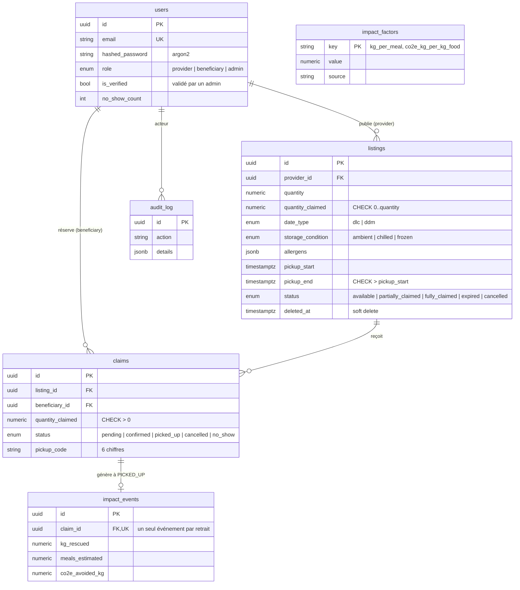
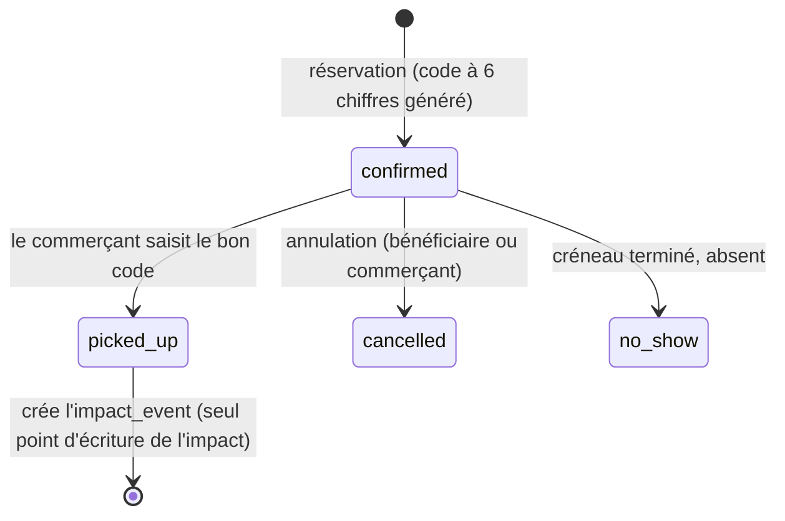

# Modèle de données

## Téléphone et confidentialité

`users.phone` est stocké au format E.164 (`+33612345678`). Il est obligatoire à l'inscription mais reste
nullable en base, pour que les comptes créés avant cette règle continuent de fonctionner (bandeau d'invitation à
le compléter). Il n'apparaît **jamais** dans les annonces. L'API le transmet (`contact_phone`) uniquement à
l'autre partie d'une réservation **en cours** ; il disparaît dès le retrait, l'annulation ou l'absence.
Des tests, validés par mutation, garantissent l'absence de fuite.

## Règles portées par la base (pas seulement par le code)

| Règle | Mécanisme |
|---|---|
| On ne réserve jamais plus que le stock | `CHECK (quantity_claimed <= quantity)` |
| Un créneau de retrait a un début et une fin cohérents | `CHECK (pickup_end > pickup_start)` |
| Un retrait ne compte qu'une fois dans l'impact | `UNIQUE (impact_events.claim_id)` |
| Un email = un compte | `UNIQUE (users.email)` |

## Hypothèses d'impact

Stockées dans `impact_factors`, pas dans le code. Valeurs initiales : `kg_per_meal = 0.4`,
`co2e_kg_per_kg_food = 2.5`. Ce sont des ordres de grandeur courants : **à sourcer (ADEME, WRAP)
et à citer dans le README avant toute publication de chiffres.**

## Cycle de vie d'une réservation

Le statut `pending` existe dans le schéma mais n'est pas utilisé en V1 : la réservation est confirmée
immédiatement. Il servira si une validation manuelle est ajoutée.

## Concurrence (implémentée)

Toute modification du stock passe par un verrou `SELECT ... FOR UPDATE` sur la ligne de l'annonce.
Ordre de verrouillage **unique** pour éviter les interblocages : bénéficiaire (si concerné), puis annonce,
puis réservation.

| Risque | Protection | Test |
|---|---|---|
| 15 personnes, 5 unités | Verrou sur l'annonce, stock relu sous verrou | `test_no_overbooking_under_concurrency` |
| Double clic du même bénéficiaire | Verrou sur le bénéficiaire + contrôle de doublon sous verrou | `test_same_beneficiary_double_click_creates_one_claim` |
| Limite de réservations actives contournée via plusieurs annonces | Verrou sur le bénéficiaire | `test_active_claims_limit_holds_across_listings` |

**Preuve par la mutation** : en retirant les `with_for_update()`, les 15 bénéficiaires obtiennent tous une
réservation sur un stock de 5, et la contrainte `CHECK` ne le détecte pas (chaque transaction écrit « 1 » à
son tour : *lost update*). Le `CHECK` est un filet de sécurité, pas la protection.
